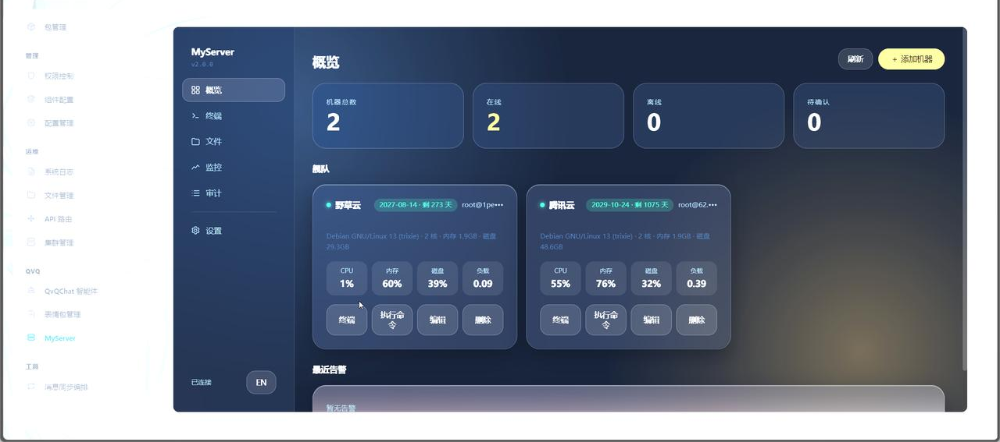
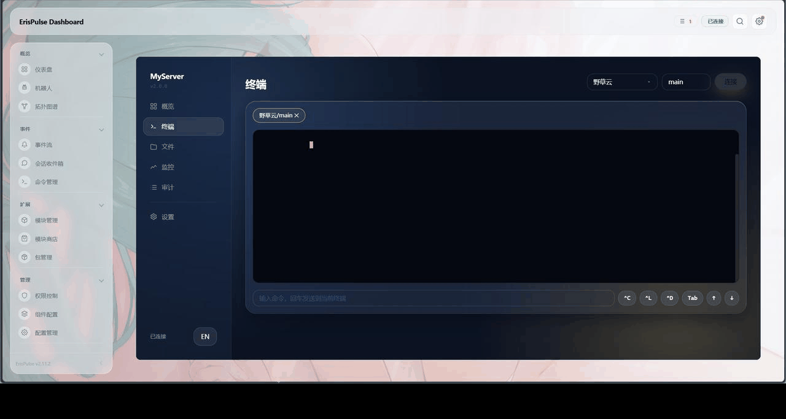
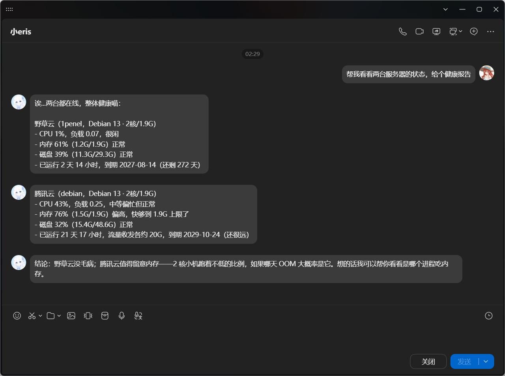
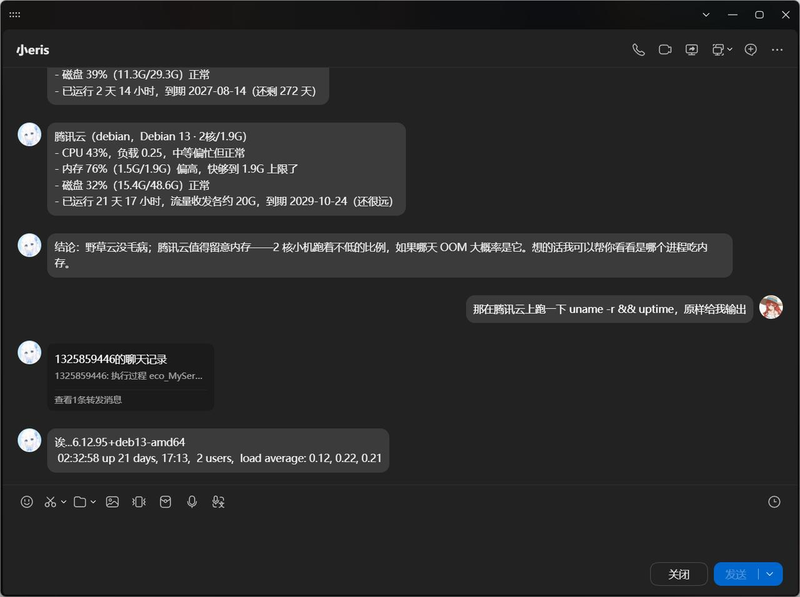
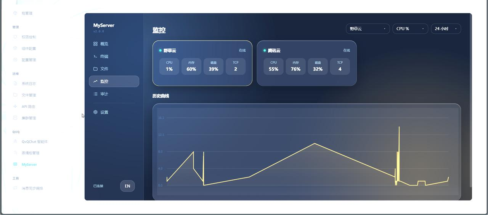
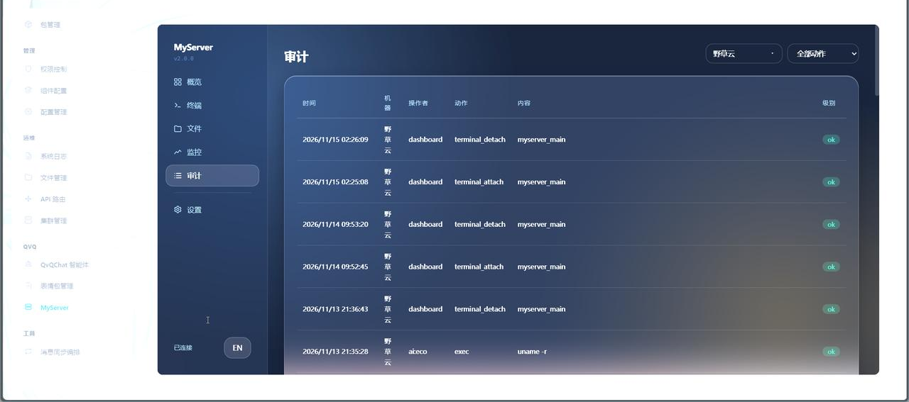

<div align="center">

简体中文 | [English](README.en.md)


</div>

# ErisPulse-MyServer

**聊天平台里的 AI 原生机房：SSH 有的全有，SSH 没有的也有——会话托管、舰队监控、危险命令确认、AI 代管、玻璃控制台。**

把你的小鸡（VPS）、你和你的机器人连起来：在 QQ / Telegram / 云湖 / Kook 等聊天窗口里看状态、跑命令、传文件、收告警；装上 [QvQChat](https://github.com/wsu2059q/ErisPulse-QvQChat) 后更进一步——AI 直接替你管机器，说「看看 web-1 什么情况」「把这个日志拉下来」就行。

## 界面

控制台（概览 / 终端 / 文件 / 监控 / 审计，五语可切）：



终端跑在远端 tmux 里，断线重连即恢复：



聊天窗口里直接看状态、跑命令（演示 bot 小eris，看板娘人设）：




监控曲线与审计（AI 的操作也在）：




## 与 SSH 客户端的本质差别：

- **会话托管**：终端跑在远端 tmux 里，MyServer 重启、断线、换设备都不丢现场，重连即恢复；聊天窗口与网页终端挂在同一会话上，两处看到同一份输出
- **危险命令防线**：`rm -rf /`、`mkfs`、`dd of=/dev/`、`shutdown` 这类命令自动拦截，三端（聊天 / 网页 / AI）统一二次确认，令牌单次有效 120 秒
- **AI 代管**（需 QvQChat）：8 个 `server_*` 工具经生态桥注册给 AI，危险操作 AI 也必须先征得你同意，全程审计可回放
- **舰队监控**：单往返指标采集，CPU / 内存 / 磁盘 / 负载阈值滞回告警（带冷却防风暴），上下线变化直接推到聊天
- **审计回放**：谁在哪台机器上做了什么全部落库，AI 能回答"上周我在 db-1 上干了什么"

<p>

  <a href="https://www.python.org/"></a> <a href="https://github.com/ErisPulse/ErisPulse"></a> <a href="./LICENSE"></a>

</p>

## 安装

基于 ErisPulse 2.8.0+。

```bash
epsdk install ErisPulse-MyServer
# 或
pip install ErisPulse-MyServer
```

## 一键部署（Docker）

```bash
curl -fsSL https://raw.githubusercontent.com/wsu2059q/ErisPulse-MyServer/main/deploy.sh | bash
```

或手动：

```bash
docker run -d \
  --name erispulse-myserver \
  -p 8000:8000 \
  -v $(pwd)/config:/app/config \
  -e TZ=Asia/Shanghai \
  -e ERISPULSE_DASHBOARD_TOKEN=你的密钥 \
  --restart unless-stopped \
  ghcr.io/wsu2059q/erispulse-myserver
```

启动后打开 `http://你的IP:8000/Dashboard`，进入「服务器机房」添加机器（SSH 密码或私钥）。

## 三种用法

**聊天命令**（纯 ErisPulse 用户）：`/server` 主菜单，`server.list` / `server.status web-1` / `server.exec web-1`（进入 tmux 终端会话）/ `server.add`。

**AI 代管**（装 QvQChat）：生态桥自动注册 `server_list` / `server_status` / `server_exec` / `server_confirm` / `server_session` / `server_upload` / `server_download` / `server_history`。查状态所有人可用，执行类仅管理员。AI 写危险命令时会被同一个确认闸拦住，它必须先向你解释并征得同意。

**玻璃控制台**（Dashboard 视窗）：概览 / 终端（xterm.js 多标签）/ 文件（SFTP 上下传）/ 监控（历史曲线）/ 审计。另有一个可独立分享的公开状态页 `/MyServer/public`（设置里开启 `public_page`，免鉴权、只读监控缓存、支持反代子路径）。

## 工作方式

指标采集是一条复合脚本在远端输出一行 JSON——每轮每台机器一次往返。会话默认落在远端 tmux（`tmux new -A`），远端没有 tmux 时自动降级为本机 PTY 并提示。所有执行、确认、会话写入、文件传输都写审计表；机器凭据在任何 API 返回里都不出现。从 1.x 升级：机器清单沿用原存储键，历史与告警表沿用原表名，装上即用。

危险命令分级是封闭词表（不是关键词泛匹配）：confirm 级拦截等确认，warn 级放行但附警告。词表见 `MyServer/safety.py`，欢迎 PR 补充。

## 与 QvQChat 配合

- `qvq_schemas` / `qvq_access`：工具参数说明与访问级别自声明
- `qvq_extensions`：向 AI 注入服务器操作安全守则（先看状态再动手、失败先解释、绝不回显密钥）
- 上传/下载的本地端落在 QvQChat 沙箱 `data/` 目录，与其发送白名单天然兼容

配置项在 Dashboard 设置页的插件分区（或 QvQChat 设置页），全部声明式：超时、管理员名单、会话上限、监控间隔、阈值组、公开页开关等。

## 相关

- [ErisPulse](https://github.com/ErisPulse/ErisPulse) — 框架
- [QvQChat](https://github.com/wsu2059q/ErisPulse-QvQChat) — 让 AI 直接管机器
- [API 端点](docs/api.md) — Dashboard HTTP/WS 全端点

## License

MIT
